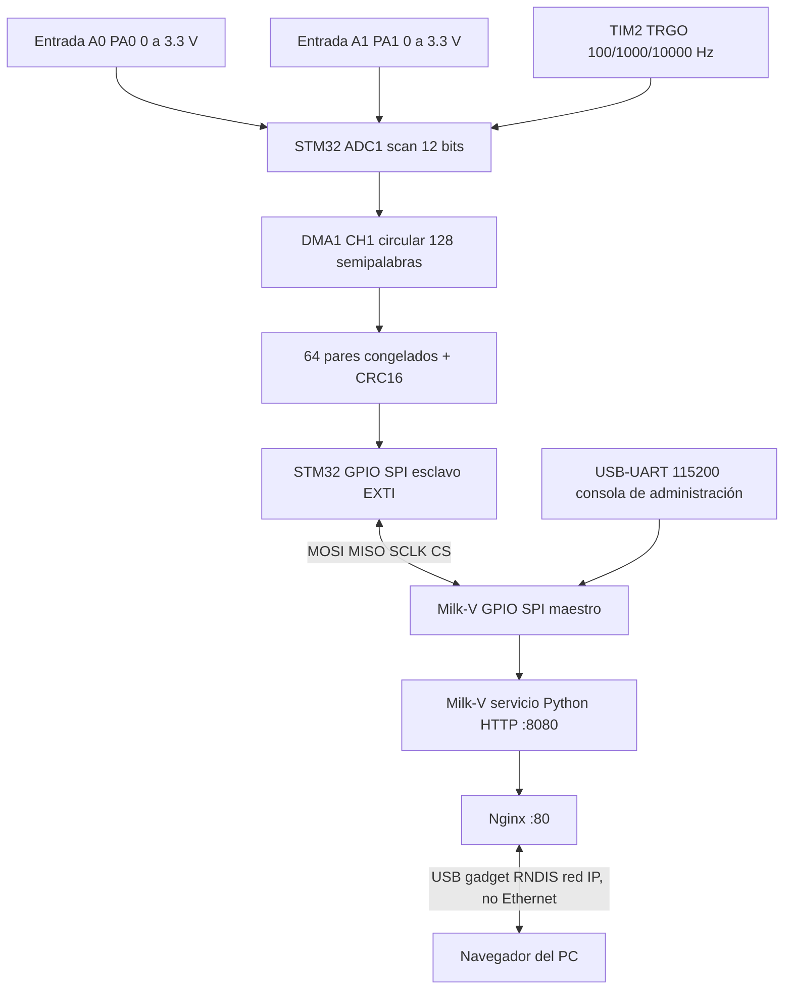

# Arquitectura / diseño

Nota: la comunicación SPI es por software; el ADC sí usa temporizador por hardware y DMA. El USB-UART es el canal de administración, no el canal de adquisición. `USB gadget` en Milk-V es el transporte de red física por USB-C hacia el PC. La entrega exige HTTP desde SBC; ejecutar dashboard en PC no lo cumpliría.

## Flujo firmware

1. Inicializa reloj HSI16, pines SPI GPIO y sus interrupciones EXTI.
2. Publica trama inicial con status 0x20. Inicializa ADC1 + calibración, TIM2 y DMA.
3. TIM2 produce cada TRGO con separación de 10ms/1ms/100us según preset.
4. ADC1 convierte PA0 y PA1 consecutivamente en cada disparo.
5. DMA recoge 128 conversiones (64 pares); el callback copia el bloque.
6. La tarea principal empaqueta la captura con cabecera, preset y CRC16.
7. Flanco CS bajo copia una trama congelada; cada flanco SCLK intercambia bits.
8. Flanco CS alto recibe el nuevo preset; el ciclo siguiente reprograma TIM2.
9. Milk-V valida cabecera, CRC, rango ADC y publica la trama por HTTP.

## Consideraciones de precisión

- La frecuencia del **inicio de la secuencia** es gobernada por TIM2. Los canales no son simultáneos, pues ADC1 realiza dos conversiones secuenciales; su desfase corresponde al tiempo de conversión del ADC.
- La referencia de tensión usada en software es 3.3 V nominal; para calibración medir VDDA real.
- La velocidad del GPIO-SPI por sysfs es muy inferior al SPI hardware. Esta implementación verifica el enlace funcional, pero no debe presentarse como comunicación SPI hardware de alta tasa.
- Se necesita medir el intervalo real de muestreo y el rendimiento efectivo SPI; no se han inventado mediciones.
